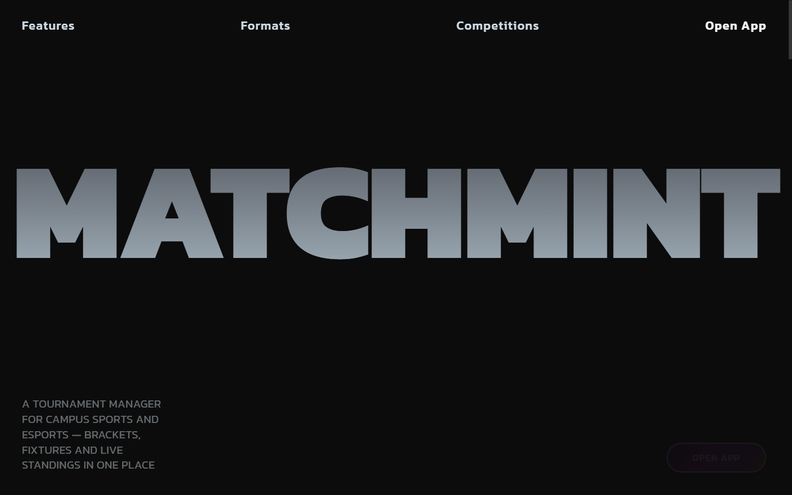
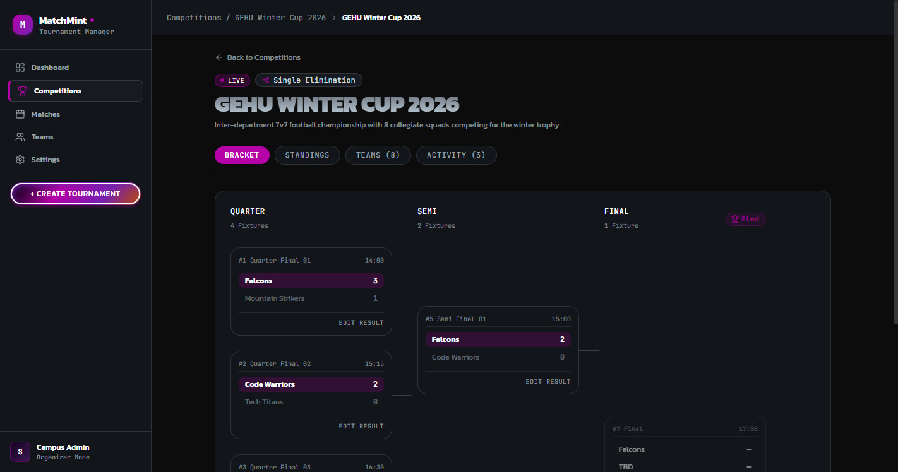
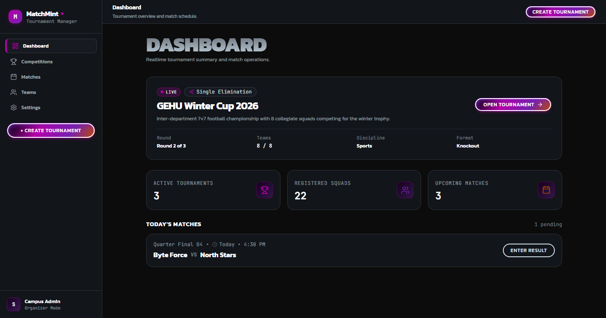
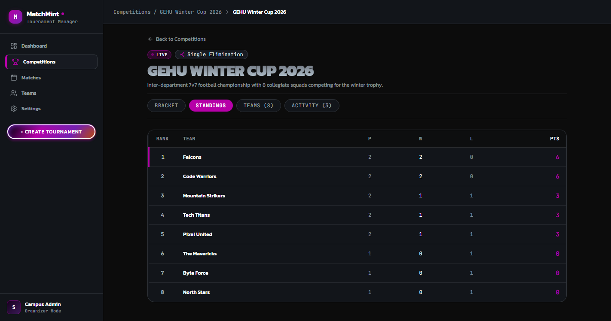
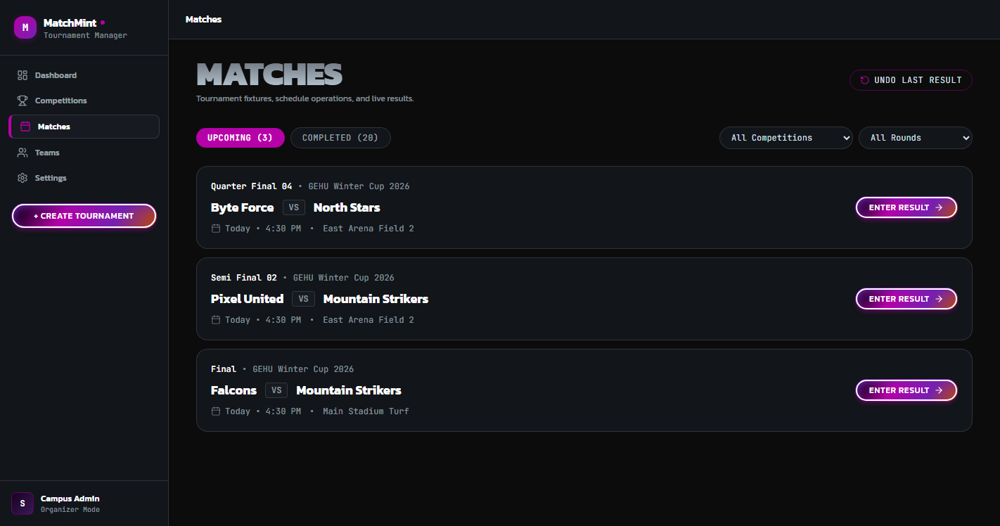
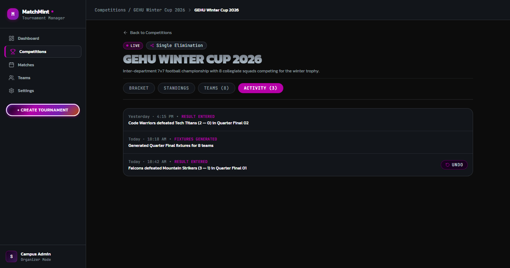
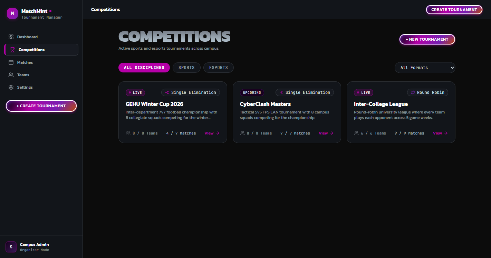
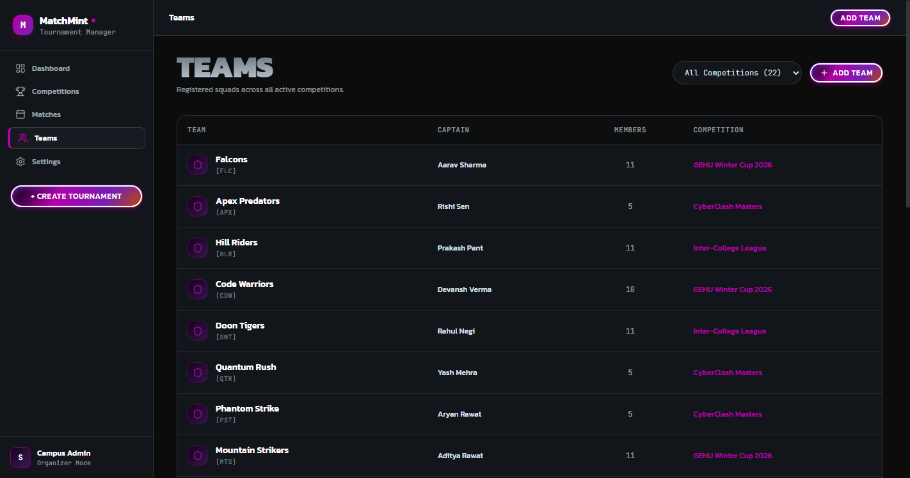
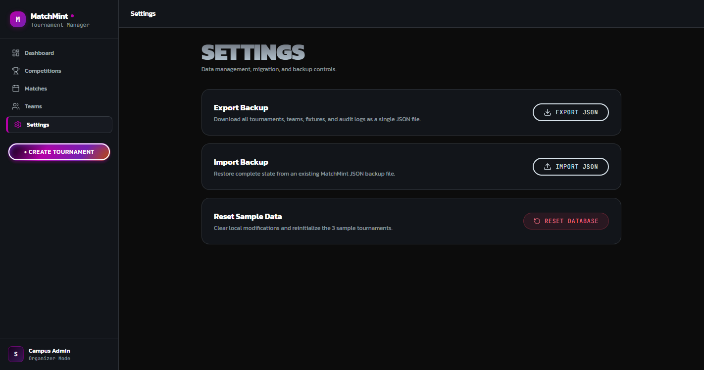
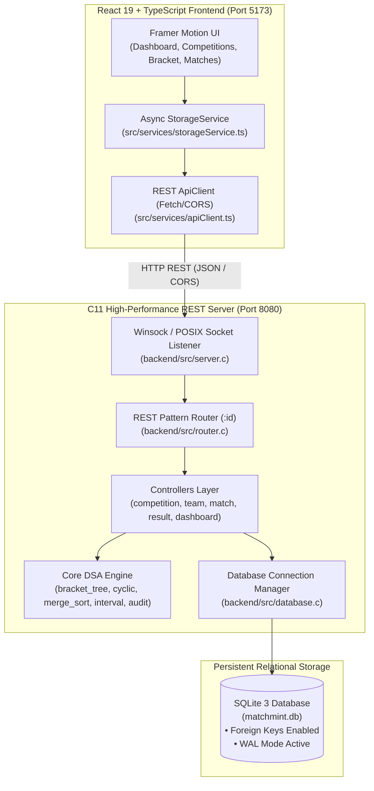

<div align="center">

# ⚡ MATCHMINT
### Cinematic Collegiate Tournament & Esports Management Engine

[](https://en.wikipedia.org/wiki/C11_(C_standard_revision))
[](https://www.sqlite.org/)
[](https://react.dev/)
[](https://www.typescriptlang.org/)
[](https://tailwindcss.com/)
[](https://www.framer.com/motion/)
[](https://vite.dev/)

<p align="center">
  <b>A production-grade collegiate sports and esports championship deck powered by a high-throughput pure C11 REST backend implementing genuine Data Structures & Algorithms (DSA), coupled with a cinematic, fluid React 19 interface.</b>
</p>

[✨ Live Features](#-key-features--visual-walkthrough) •
[🧠 DSA Mapping](#-core-dsa-algorithms--pbl-mapping) •
[🏛️ Architecture](#-system-architecture) •
[📡 REST Endpoints](#-rest-api-specification) •
[🚀 Quickstart](#-getting-started) •
[🧪 Verification](#-test-suites--verification)

---



</div>

---

## 🌟 Overview

**MatchMint** bridges collegiate athletic and gaming championships with modern systems programming. Instead of relying on client-side state or bulky interpreted frameworks, MatchMint places a **native, compiled C11 server** at the heart of the platform.

All bracket structures, round-robin schedules, standings sorting, conflict checks, and audit rollbacks are executed by **custom-crafted C Data Structures & Algorithms (DSA)** running against an embedded SQLite3 engine with Write-Ahead Logging (WAL) and foreign key integrity.

The frontend is an editorial-grade **React 19 + TypeScript** application built with Tailwind CSS and Framer Motion 12, featuring a dark canvas (`#0C0C0C`, `#12151a`), neon magenta accents (`#B600A8`), and responsive, sub-millisecond API responsiveness.

---

## 📸 Key Features & Visual Walkthrough

### 1. Interactive Knockout Binary Tree Bracket Engine
> Powered by `bracket_tree.c` • Time Complexity: $\mathcal{O}(N)$ creation, $\mathcal{O}(\log N)$ auto-advancement



- **Fold Seeding**: Automatically pairs high seeds against lower seeds ($1 \text{ vs } 8$, $4 \text{ vs } 5$, $2 \text{ vs } 7$, $3 \text{ vs } 6$) to ensure fair tournament progression.
- **Tree Slot Advancement**: Entering scores in a round automatically evaluates the winner and assigns their pointer to the parent slot in the next round (`Quarter -> Semi -> Final`).
- **Visual Feedback**: Real-time bracket tree connectors, winner highlights, and responsive status states.

---

### 2. Tournament Command Deck & Platform Metrics
> High-level statistical aggregation across tournaments, squads, and daily match schedules



- **Platform KPI Deck**: Displays active tournaments, registered squads, pending matches, and student athletes in real time.
- **Today's Match Operations**: Quick score entry and status monitoring for ongoing games.
- **Persistent Left Navigation**: Seamless tab routing between Dashboard, Tournaments, Matches, Squads, and Settings.

---

### 3. Multi-Attribute Merge-Sorted Standings
> Powered by `merge_sort.c` • Time Complexity: $\mathcal{O}(N \log N)$ Stable Divide-and-Conquer



- **Comprehensive Collegiate Tie-Breaking**: Ranks teams stably using standard collegiate multi-attribute priority:
  $$\text{Points} \longrightarrow \text{Goal Difference (GD)} \longrightarrow \text{Goals For (GF)} \longrightarrow \text{Total Wins} \longrightarrow \text{Seed}$$
- **Zero Inversion Bias**: Implements merge sort with guaranteed stability to prevent rank fluctuation among tied squads.
- **Visual Distinction**: First-place team highlighted with a custom accent bar (`#B600A8`) and tabular monospaced numbers.

---

### 4. Match Management & 1D Interval Overlap Scheduling
> Powered by `interval_conflict.c` • Time Complexity: $\mathcal{O}(N \log N)$ Conflict Detection



- **Interval Overlap Collision Detection**: Evaluates match start and end timestamps against shared venues:
  $$\text{Collision} \iff (\text{start}_A < \text{end}_B) \land (\text{end}_A > \text{start}_B) \quad \text{where Venue}_A = \text{Venue}_B$$
- **Smart Rescheduling**: Re-allocates pitches and time slots with instant feedback alerts before saving to SQLite.
- **Round & Status Filters**: Filter by discipline (Sports / Esports), format (Single Elimination / Round Robin), and status (Upcoming / Completed).

---

### 5. Downstream-Safe Result Rollback & LIFO Audit Trail
> Powered by `audit_list.c` • Time Complexity: $\mathcal{O}(1)$ Push/Pop, $\mathcal{O}(1)$ Inspection



- **One-Click Instant Undo**: Mistakes happen. Organizers can undo scores with a single click, reverting match statuses to `upcoming` and recalculating leaderboards automatically.
- **Downstream Bracket Safety Invariant**: Prevents rollbacks if a subsequent match in the bracket has already finished (`DOWNSTREAM_COMPLETED`), protecting bracket integrity from corrupted state cascades.
- **Full History Journal**: Logs all fixture generation events, score changes, and rollback actions with ISO timestamps.

---

### 6. Tournament Catalog & Squad Directory
> Multi-discipline support with automatic seed calculation and tag derivations

| Tournaments Catalog | Squads Directory |
| :---: | :---: |
|  |  |
| Filter by Sports vs Esports, Single Elimination vs Round Robin. | Track player rosters, captains, seed numbers, and contacts. |

---

### 7. Backup, Data Migration & Instant Reset
> Full platform portability and state management



- **Full JSON Export/Import**: Export the entire database state (competitions, squads, matches, history) into a portable JSON document.
- **Seed Reset**: Instant atomic restoration to verified sample collegiate tournaments (GEHU Winter Cup, CyberClash Masters, Inter-College League).

---

## 🧠 Core DSA Algorithms & PBL Mapping

| Module | Data Structure / Algorithm | File Location | Real-World Tournament Application | Time Complexity |
|---|---|---|---|:---:|
| **1. Bracket Engine** | Binary Tree (Hierarchical Tree) | [`backend/src/dsa/bracket_tree.c`](backend/src/dsa/bracket_tree.c) | Single-elimination fold pairing, parent/child node linkages, and automatic winner promotion. | $\mathcal{O}(N)$ build<br>$\mathcal{O}(\log N)$ advance |
| **2. Round-Robin Scheduler** | Cyclic Fixed-Pivot Rotation (Circle Method) | [`backend/src/dsa/cyclic_schedule.c`](backend/src/dsa/cyclic_schedule.c) | Fair round-robin fixture generation; fixes index 0, rotates remainder, pairs home/away, handles odd BYE teams. | $\mathcal{O}(N^2)$ fixtures |
| **3. Standings Sorter** | Multi-Attribute Merge Sort | [`backend/src/dsa/merge_sort.c`](backend/src/dsa/merge_sort.c) | Stable divide-and-conquer leaderboard ranking: Points $\rightarrow$ GD $\rightarrow$ GF $\rightarrow$ Wins $\rightarrow$ Seed. | $\mathcal{O}(N \log N)$ guaranteed |
| **4. Conflict Detector** | 1D Interval Overlap Detection | [`backend/src/dsa/interval_conflict.c`](backend/src/dsa/interval_conflict.c) | Detects venue and time slot collisions ($S_1 < E_2 \land E_1 > S_2$) across arenas and pitches. | $\mathcal{O}(N \log N)$ sorted<br>$\mathcal{O}(N^2)$ pairwise |
| **5. Audit Rollback Trail** | Dynamic LIFO Linked List | [`backend/src/dsa/audit_list.c`](backend/src/dsa/audit_list.c) | In-memory stack of match state snapshots with downstream child safety guards. | $\mathcal{O}(1)$ push / lookup |

---

## 🏛️ System Architecture



---

## 📡 REST API Specification

The C11 backend server exposes **25 standard RESTful endpoints** at `/api/v1/*`:

### 🏆 Competitions & Teams
- `GET /api/v1/competitions` — List all tournaments with filters
- `GET /api/v1/competitions/:id` — Retrieve tournament detail
- `POST /api/v1/competitions` — Create new tournament
- `PUT /api/v1/competitions/:id` — Update tournament settings
- `GET /api/v1/teams` — Query squads (supports `?competitionId=...`)
- `GET /api/v1/teams/:id` — Retrieve squad profile
- `POST /api/v1/teams` — Register new team squad

### ⚔️ Tournament Engine & Fixtures
- `GET /api/v1/matches` — Query fixtures (supports `?competitionId=...&status=...&round=...`)
- `GET /api/v1/matches/:id` — Query single match detail
- `POST /api/v1/competitions/:id/generate-fixtures` — Trigger DSA bracket/cyclic engine
- `GET /api/v1/competitions/:id/bracket` — Retrieve binary tree bracket hierarchy
- `PATCH /api/v1/matches/:id/schedule` — Reschedule match & check collisions

### 🎯 Scorekeeping, Standings & Undo
- `POST /api/v1/matches/:id/result` — Enter score, auto-advance winner & sort standings
- `GET /api/v1/competitions/:id/standings` — Retrieve merge-sorted leaderboard
- `GET /api/v1/competitions/:id/history` — Retrieve LIFO audit trail for tournament
- `GET /api/v1/history` — Retrieve platform-wide audit log
- `POST /api/v1/history/:id/undo` — Execute safe result rollback

### 📊 Dashboard, Venues & Maintenance
- `GET /api/v1/dashboard/metrics` — Aggregate platform statistics
- `GET /api/v1/dashboard/today-matches` — List matches scheduled for today
- `GET /api/v1/venues` — List distinct tournament venues
- `POST /api/v1/competitions/:id/check-conflicts` — Batch interval collision check
- `GET /api/v1/settings/backup/export` — Download full database JSON backup
- `POST /api/v1/settings/backup/import` — Restore database from JSON backup
- `POST /api/v1/settings/reset` — Reset database to collegiate sample defaults
- `GET /api/v1/health` — Service health check

---

## 🚀 Getting Started

### Prerequisites
- **C Compiler**: MinGW-w64 GCC (v11+) or Clang with C11 support.
- **Build Tool**: CMake (v3.20+) and `mingw32-make` / `make`.
- **Node.js**: Node.js (v18+) and `npm`.
- **Libraries**: SQLite3 C runtime and OpenSSL headers.

---

### Step 1: Clone Repository
```bash
git clone https://github.com/Sujalkholiya/MatchMint.git
cd MatchMint
git checkout development
```

---

### Step 2: Build & Start C11 Backend Server
```bash
# Configure CMake build system
cmake -B backend/build -S backend -G "MinGW Makefiles"

# Compile server and all test suites
cmake --build backend/build

# Launch high-performance REST backend on port 8080
./backend/build/matchmint_server.exe
```
> The C server will initialize SQLite schema, apply initial collegiate seeds, and listen on `http://localhost:8080/api/v1`.

---

### Step 3: Install & Launch React Frontend
In a new terminal:
```bash
# Install frontend dependencies
npm install

# Start Vite development server
npm run dev
```
> Open **`http://localhost:5173`** in your browser.

---

## 🧪 Test Suites & Verification

MatchMint includes comprehensive test coverage for both the C backend and React frontend.

### Run All Backend Unit & Integration Tests:
```powershell
# 1. Test pure DSA algorithms (Binary Tree, Cyclic, Merge Sort, Intervals, List)
./backend/build/test_dsa.exe

# 2. Test HTTP Server & REST Router parameter extraction
./backend/build/test_server.exe

# 3. Test Competition & Team Management APIs
./backend/build/test_competition_team_api.exe

# 4. Test Tournament Engine & Fixture Generation APIs
./backend/build/test_match_api.exe

# 5. Test Result Entry, Standings & Downstream Rollback Safety
./backend/build/test_result_api.exe

# 6. Test Dashboard Metrics, Venues & Backup Reset APIs
./backend/build/test_dashboard_settings_api.exe
```

### Run Frontend Production Build & Linter:
```bash
# Run TypeScript compilation and Vite production bundling
npm run build

# Run fast linter
npm run lint
```

---

## 📂 Project Directory Structure

```text
MatchMint/
├── backend/                        # C11 REST Backend
│   ├── CMakeLists.txt              # CMake build configuration
│   ├── database/
│   │   ├── schema.sql              # Relational SQLite schema (indexes, FKs)
│   │   └── seed.sql                # Sample collegiate tournament dataset
│   ├── docs/
│   │   └── dsa_mapping.md          # Problem-Based Learning DSA documentation
│   ├── include/                    # C header declarations
│   │   ├── common.h, controllers.h, database.h, dsa.h
│   │   ├── http.h, json_util.h, response.h, router.h, server.h
│   ├── src/
│   │   ├── main.c                  # Server entry point & route definitions
│   │   ├── server.c, router.c, response.c, json_util.c, database.c
│   │   ├── controllers/            # REST API controller handlers
│   │   └── dsa/                    # 5 Pure DSA Algorithm Modules
│   └── tests/
│       ├── unit/                   # test_dsa.c, test_server.c
│       └── integration/            # test_*_api.c suites
├── docs/
│   └── screenshots/                # High-definition application screenshots
├── src/                            # React 19 Frontend
│   ├── components/                 # UI components, badges, modals, cards
│   ├── pages/                      # Dashboard, Competitions, Matches, Teams, Settings
│   ├── services/
│   │   ├── apiClient.ts            # Centralized typed HTTP fetch client
│   │   ├── storageService.ts       # Modernized asynchronous backend adapter
│   │   └── tournamentEngine.ts     # Client utilities & conflict interfaces
│   ├── types/                      # TypeScript domain interfaces
│   ├── App.tsx                     # Main layout & router controller
│   └── main.tsx                    # React DOM root entry
├── package.json                    # Frontend dependencies & scripts
├── tailwind.config.js              # Theme colors & fonts configuration
└── README.md                       # Project documentation
```

---

## 🎨 Design Philosophy & Color System

MatchMint utilizes a dark theme (`#0C0C0C`, `#12151a`) accented by magenta pills:

| Token | Hex Code | Visual Application |
|---|---|---|
| **Canvas** | `#0C0C0C` | Deep background surface |
| **Card Surface** | `#12151a` | Elevated tournament and match cards |
| **Card Hover** | `#171a21` | Interactive card hover state |
| **Border Stroke** | `rgba(215, 226, 234, 0.15)` | Clean borders and division lines |
| **Text Primary** | `#D7E2EA` | High-contrast editorial typography |
| **Accent Glow** | `#B600A8` | Active tab indicator, first-place badge, neon buttons |
| **Pill Gradient** | `#18011F` $\rightarrow$ `#B600A8` $\rightarrow$ `#BE4C00` | Signature primary CTA button fill |

---

## 📄 License & Credits

- **Project**: MatchMint — Collegiate Tournament Management System
- **Repository**: [github.com/Sujalkholiya/MatchMint](https://github.com/Sujalkholiya/MatchMint)
- **Built for**: Advanced Collegiate Sports & Esports Operations

---

<div align="center">
  <sub>Engineered with precision in C11 & React 19. Crafted for collegiate champions.</sub>
</div>
